# Практические занятия. Основы криптографии

**Дисциплина:** Информационная безопасность и защита информации
**Студент:** Ловенецкая Майя Алексеевна, **вариант №15**
**Преподаватель:** Корецкий Владимир Павлович

**Цель работы:** изучить криптографические примитивы, симметричные шифры, терминологию, выявить проблемы и задачи современной криптографии.

---

## Теоретические основы

- **Открытый текст** — исходное, незашифрованное сообщение, которое нужно защитить.
- **Шифротекст** — результат шифрования открытого текста.
- **Криптография** — наука о методах обеспечения конфиденциальности, целостности и аутентичности данных с помощью математических преобразований (шифрование, хеширование, подпись).
- **Криптоанализ** — наука о методах вскрытия шифров: получения открытого текста или ключа без знания секретного ключа.
- **Шифр замены (подстановки)** — шифр, в котором символы открытого текста заменяются другими символами (или группами символов) по определённому правилу.
- **Моноалфавитный шифр** — шифр замены, где для всего сообщения используется одна таблица замены (один алфавит шифрования), одной букве всегда соответствует одна и та же буква шифротекста.
- **Полиалфавитный шифр** — шифр замены, где используется несколько алфавитов шифрования, и один и тот же символ открытого текста в разных позициях заменяется по-разному.
- **Симметричные криптосистемы** — системы, в которых шифрование и расшифрование выполняются с одним и тем же секретным ключом.
- **Ключ шифрования** — секретная последовательность символов, используемая для превращения открытого текса в шифротекст и наоборот.
- **Пространство ключей** — множество всех возможных значений ключа.
- **Криптографическая стойкость** — способность шифра противостоять криптоанализу.
- **Криптографическая атака** — попытка криптоаналитика вскрыть шифр: найти ключ или открытый текст (перебор, частотный анализ, атаки с известным/подобранным открытым текстом и т.д.).
- **Частотный анализ** — метод криптоанализа, основанный на статистике языка.
---

## Задание №1. Шифр Цезаря (ROT15)

Вариант 15 → сдвиг **N = 15**: `c = (p + 15) mod 33`.

**Открытый текст:**

Бизнес-информатика В рамках направления ведётся подготовка будущих лидеров IT-индустрии. Программа включает в себя изучение теоретических принципов и приобретение практических навыков при решении задач анализа, моделирования и управления бизнес-процессами предприятия, анализа и определение направлений рационализации архитектуры предприятия. Значительное внимание уделяется изучению методик и инструментальных средств для анализа и моделирования организационных и технологических процессов на предприятиях, а также различным типам систем их автоматизации: информационным системам управления ресурсами предприятия, производственным исполнительным системам, системам управления активами предприятия, системам корпоративного электронного документооборота, системам поддержки оперативной деятельности, бизнеса или бизнес-процессов.

**Шифротекст (ROT15):**

Пчцьуа-чьгэяыобчщо Р яоыщод ьоюяоръуьчн рутфбан юэтсэбэрщо пвтвзчд ъчтуяэр IT-чьтвабячч. Юяэсяоыыо рщъмёоуб р аупн чцвёуьчу буэяубчёуащчд юячьечюэр ч юячэпяубуьчу юяощбчёуащчд ьорйщэр юяч яужуьчч цотоё оьоъчцо, ыэтуъчяэроьчн ч вюяоръуьчн пчцьуа-юяэеуааоыч юяутюячнбчн, оьоъчцо ч эюяутуъуьчу ьоюяоръуьчш яоечэьоъчцоечч оядчбущбвяй юяутюячнбчн. Цьоёчбуъкьэу рьчыоьчу втуънубан чцвёуьчм ыубэтчщ ч чьабявыуьбоъкьйд аяутабр тън оьоъчцо ч ыэтуъчяэроьчн эясоьчцоечэььйд ч будьэъэсчёуащчд юяэеуааэр ьо юяутюячнбчнд, о бощху яоцъчёьйы бчюоы ачабуы чд орбэыобчцоечч: чьгэяыоечэььйы ачабуыоы вюяоръуьчн яуавяаоыч юяутюячнбчн, юяэчцрэтабруььйы чаюэъьчбуъкьйы ачабуыоы, ачабуыоы вюяоръуьчн ощбчроыч юяутюячнбчн, ачабуыоы щэяюэяобчрьэсэ лъущбяэььэсэ тэщвыуьбээпэяэбо, ачабуыоы юэттуяхщч эюуяобчрьэш тунбуъкьэабч, пчцьуао чъч пчцьуа-юяэеуааэр.


### Ответы на вопросы

1. **Полиалфавитный или моноалфавитный?** Моноалфавитный
2. **Симметричная или асимметричная?** Симметричная
3. **Пространство ключей.** 32·33!
4. **Достоинства:** предельная простота, не нужна техника, быстро шифруется и расшифровывается вручную, ключ — одно число. **Недостатки:** сохраняются частоты букв, слова и длины слов, поэтому легко вскрывается частотным анализом, при известной паре «открытый текст — шифротекст» ключ находится по одной букве.
5. **Математическое описание.** Пусть буква имеет номер x ∈ {0, …, 32}, k — ключ, модуль 33:
   - шифрование: **y = (x + k) mod 33**
   - расшифрование: **x = (y − k) mod 33**


## Задание №2. Шифр Виженера

**Ключ** (имя и фамилия): «Майя Ловенецкая» → **`майяловенецкая`** (длина 14).

**Открытый текст** (без пробелов и знаков препинания): `безопасностьинформациитакоесостояниезащищенностиинформацииприкоторомобеспеченыеёконфиденциальностьцелостностьидоступность`

Шифрование: `c_i = (p_i + k_(i mod 14)) mod 33`. (Корректность реализации проверена на примере из методички: «сегоднявстречаемсяввосемь» с ключом «привет» → БХЛРИАОТЪФХЧЖРНОЦССТЧУЙЯЛ.)

**Шифротекст:**

`НЕСНЫОУТЬЦИЖИМБОЪЛЛЕКНАЕБЩЕРЫСЬНКЬКЙХЕПУЩДЪНШРЮЧКТВУЖЧАХХИЩПФЩРЧЬХЕЧОАССЩДГУПАТКБЩНУХДОМВЧВРЙТЕЬТЫГЕХНЭБПУЯЧТУДНЮТЭОЩЭУЧЙ`

Пошаговая таблица шифрования:

| № | Открытая буква | Буква ключа | Шифрбуква |
|---|---|---|---|
| 1 | б | м | н |
| 2 | е | а | е |
| 3 | з | й | с |
| 4 | о | я | н |
| 5 | п | л | ы |
| 6 | а | о | о |
| 7 | с | в | у |
| 8 | н | е | т |
| 9 | о | н | ь |
| 10 | с | е | ц |
| 11 | т | ц | и |
| 12 | ь | к | ж |
| 13 | и | а | и |
| 14 | н | я | м |
| 15 | ф | м | б |
| 16 | о | а | о |
| 17 | р | й | ъ |
| 18 | м | я | л |
| 19 | а | л | л |
| 20 | ц | о | е |
| 21 | и | в | к |
| 22 | и | е | н |
| 23 | т | н | а |
| 24 | а | е | е |
| 25 | к | ц | б |
| 26 | о | к | щ |
| 27 | е | а | е |
| 28 | с | я | р |
| 29 | о | м | ы |
| 30 | с | а | с |
| 31 | т | й | ь |
| 32 | о | я | н |
| 33 | я | л | к |
| 34 | н | о | ь |
| 35 | и | в | к |
| 36 | е | е | й |
| 37 | з | н | х |
| 38 | а | е | е |
| 39 | щ | ц | п |
| 40 | и | к | у |
| 41 | щ | а | щ |
| 42 | е | я | д |
| 43 | н | м | ъ |
| 44 | н | а | н |
| 45 | о | й | ш |
| 46 | с | я | р |
| 47 | т | л | ю |
| 48 | и | о | ч |
| 49 | и | в | к |
| 50 | н | е | т |
| 51 | ф | н | в |
| 52 | о | е | у |
| 53 | р | ц | ж |
| 54 | м | к | ч |
| 55 | а | а | а |
| 56 | ц | я | х |
| 57 | и | м | х |
| 58 | и | а | и |
| 59 | п | й | щ |
| 60 | р | я | п |
| 61 | и | л | ф |
| 62 | к | о | щ |
| 63 | о | в | р |
| 64 | т | е | ч |
| 65 | о | н | ь |
| 66 | р | е | х |
| 67 | о | ц | е |
| 68 | м | к | ч |
| 69 | о | а | о |
| 70 | б | я | а |
| 71 | е | м | с |
| 72 | с | а | с |
| 73 | п | й | щ |
| 74 | е | я | д |
| 75 | ч | л | г |
| 76 | е | о | у |
| 77 | н | в | п |
| 78 | ы | е | а |
| 79 | е | н | т |
| 80 | ё | е | к |
| 81 | к | ц | б |
| 82 | о | к | щ |
| 83 | н | а | н |
| 84 | ф | я | у |
| 85 | и | м | х |
| 86 | д | а | д |
| 87 | е | й | о |
| 88 | н | я | м |
| 89 | ц | л | в |
| 90 | и | о | ч |
| 91 | а | в | в |
| 92 | л | е | р |
| 93 | ь | н | й |
| 94 | н | е | т |
| 95 | о | ц | е |
| 96 | с | к | ь |
| 97 | т | а | т |
| 98 | ь | я | ы |
| 99 | ц | м | г |
| 100 | е | а | е |
| 101 | л | й | х |
| 102 | о | я | н |
| 103 | с | л | э |
| 104 | т | о | б |
| 105 | н | в | п |
| 106 | о | е | у |
| 107 | с | н | я |
| 108 | т | е | ч |
| 109 | ь | ц | т |
| 110 | и | к | у |
| 111 | д | а | д |
| 112 | о | я | н |
| 113 | с | м | ю |
| 114 | т | а | т |
| 115 | у | й | э |
| 116 | п | я | о |
| 117 | н | л | щ |
| 118 | о | о | э |
| 119 | с | в | у |
| 120 | т | е | ч |
| 121 | ь | н | й |


### Ответы на вопросы

1. **Полиалфавитный или моноалфавитный?** Моноалфавитный
2. **Симметричная или асимметричная?** Симметричная
3. **Пространство ключей.** Для ключа длины m — 33^m вариантов.
4. **Достоинства:** скрывает частоты отдельных букв (частотный анализ «в лоб» не работает), ключей намного больше, чем у Цезаря, прост в ручной реализации. **Недостатки:** ключ нужно заранее передать, нет защиты от подмены. 
5. **Связь с шифром Цезаря.** Шифр Виженера — последовательность шифров Цезаря с разными сдвигами, задаваемыми буквами ключа.
6. **Математическое описание.** 
   - шифрование: **c_i = (p_i + k_i) mod 33**;
   - расшифрование: **p_i = (c_i − k_i) mod 33**.


## Задание №3. Гомофоническая (омофоническая) замена

**Таблица-ключ.**

| Буква | а | б | в | г | д | е | ё | ж | з | и | й | к | л | м | н | о | п | р | с | т | у | ф | х | ц | ч | ш | щ | ъ | ы | ь | э | ю | я |
|---|---|---|---|---|---|---|---|---|---|---|---|---|---|---|---|---|---|---|---|---|---|---|---|---|---|---|---|---|---|---|---|---|---|
| 1-й | 63 | 19 | 14 | 47 | 194 | 129 | 110 | 68 | 90 | 140 | 157 | 135 | 154 | 155 | 113 | 193 | 146 | 83 | 48 | 111 | 191 | 164 | 32 | 160 | 40 | 31 | 195 | 53 | 196 | 44 | 192 | 120 | 43 |
| 2-й | 12 | 50 | 24 | 187 | 39 | 101 | 77 | 62 | 67 | 117 | 126 | 30 | 102 | 175 | 26 | 60 | 54 | 145 | 35 | 22 | 85 | 74 | 79 | 55 | 49 | 115 | 59 | 66 | 106 | 119 | 185 | 58 | 21 |
| 3-й | 143 | 71 | 184 | 104 | 96 | 81 | 98 | 100 | 88 | 69 | 171 | 128 | 122 | 125 | 166 | 45 | 163 | 136 | 186 | 28 | 112 | 197 | 131 | 20 | 168 | 159 | 70 | 181 | 142 | 172 | 73 | 11 | 46 |

**Открытый текст:** «Ловенецкая Майя Алексеевна» → `ловенецкаямайяалексеевна` (24 букв).

**Шифротекст:**

`154 193 14 129 113 101 160 135 63 43 155 12 157 21 143 102 81 30 48 129 101 24 26 63`


### Ответы на вопросы

1. **Полиалфавитный или моноалфавитный?** Полиалфавитной
2. **Симметричная или асимметричная?** Симметричная
3. **Пространство ключей.** Если 99 различных кодов распределяются между 33 буквами с учётом порядка использования гомофонов, то ключей **99! ≈ 9.33e+155** (≈ 2^518)
4. **Достоинства:** сглаживает частоты букв — простой частотный анализ по одиночным символам неэффективен; огромное пространство ключей. **Недостатки:** шифротекст длиннее открытого (при 2–3-значных числах в несколько раз), ключ-таблица велика, её нужно хранить и безопасно передавать.
5. **Математическое описание.** Пусть 𝒜 — алфавит открытого текста (|𝒜| = 33), 𝒞 — множество кодов (|𝒞| = 99), ключ — отображение T: 𝒜 → 𝒞³, T(a) = (t₁(a), t₂(a), t₃(a)) с попарно непересекающимися образами. Для i-го символа p_i с n_i = #{j < i : p_j = p_i} предыдущими вхождениями: **c_i = t_((n_i mod 3) + 1)(p_i)**. Расшифрование — однозначное отображение **D(c) = a ⇔ c ∈ T(a)**.
6. **Можно ли считать генератором псевдослучайных чисел?** Нет.


## Задание №4. Усложнённая перестановка

**Открытый текст:** «Меня зовут Майя Ловенецкая!» (пробелы заменены на `_`, всего 27 символов)
**Ключи:** K1 = 2 1 4 5 6 3, K2 = 2 3 1 5 4.

**Шаг 1.** Разбиваем на группы по 6 символов и переставляем по K1:

| Группа | Открытый текст | После перестановки по K1 |
|---|---|---|
| 1 | Меня_з | еМя_зн |
| 2 | овут_М | вот_Му |
| 3 | айя_Ло | йа_Лоя |
| 4 | венецк | евецкн |
| 5 | ая! | яа_ |

Шифротекст C1 = `еМя_знвот_Муйа_Лояевецкняа_`

**Шаг 2.** C1 записывается в матрицу 6×5 по столбцам сверху вниз:
| Строка \ Столбец | 1 | 2 | 3 | 4 | 5 |
|---|---|---|---|---|---|
| 1 | е | в | й | е | я |
| 2 | М | о | а | в | а |
| 3 | я | т | _ | е | _ |
| 4 | _ | _ | Л | ц | _ |
| 5 | з | М | о | к | _ |
| 6 | н | у | я | н | _ |

**Шаг 3.** Читаем матрицу по K2 = 2 3 1 5 4: от нижней строки вверх, в каждой строке столбцы идут в порядке K2.

**Итоговый шифротекст C2:**

`уян_нМоз_к_Л__цт_я_еоаМаввйеяе`


### Ответы на вопросы

1. **Достоинства:** сохраняется весь набор символов; просто и быстро, без таблиц замены; усложнённая (двойная) перестановка заметно труднее простой. **Недостатки:** частоты одиночных букв остаются теми же, что в языке? нужна набивка до размера блока.
2. **Классификация.**
   - *Симметричные / асимметричные:* и шифры замены (Цезарь, Виженер, омофоническая), и перестановки — **симметричные** (один секретный ключ у обеих сторон).
   - *Моно- / полиалфавитные:* Цезарь — моноалфавитный, Виженер — моноалфавитный, омофоническая замена — полиалфавитный
3. **Применение в современной криптографии (творческий вопрос).** Да, но не самостоятельно, а как составная часть блочных шифров и других конструкций, где перестановки создают рассеивание. Чистая перестановка небезопасна (сохраняет частоты), но в связке с подстановкой она — основа принципа Шеннона «confusion & diffusion».


## Задание №5. Криптографическая атака — частотный анализ

**Диаграмма частот букв шифротекста:**

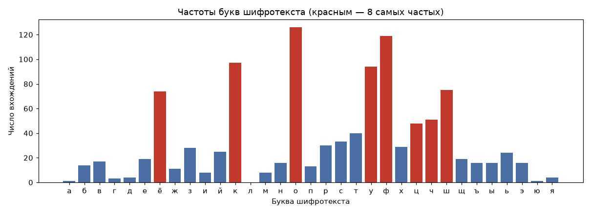

Для сравнения — диаграмма частот русского языка (табл. 2):

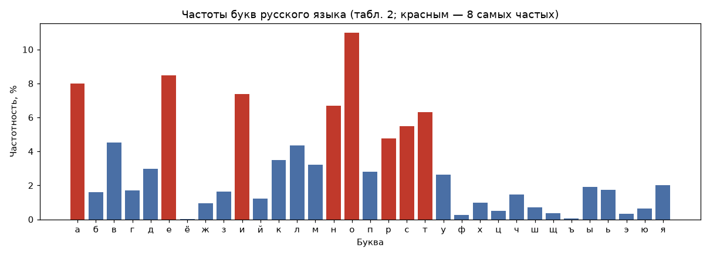

С учетом этих диаграмм можно постепенно заменять наиболее часто встречающиеся буквы в шифротексте на наиболее часто встречающиеся в русском языке.


**Расшифровка первого фрагмента**:

подбезопасностьюинформациипонимаетсятакоееесостояниеприкоторомисключаетсявозможностьпросмотраизмененияилиуничтоженияинформациилицаминеимеющиминаэтоправаатакжеутечкиинформациизасчетпобочныхэлектромагнитныхизлученийинаводокспециальныхустройствперехвата(уничтожения)припередачемеждуобъектамивычислительнойтехникитакжекинформационнойбезопасностиотноситсязащитаинформацииотнепреднамеренногоуничтожения(техническиесбои)защитаинформацииэтосовокупностьмероприятийнаправленныхнаобеспечениеконфиденциальностиицелостностиобрабатываемойинформацииатакжедоступностиинформациидляпользователейконфиденциальностьсохранениевсекретекритичнойинформациидоступккоторойограниченузкимкругомпользователей(отдельныхлицилиорганизаций)целостностьсвойствоприналичиикоторогоинформациясохраняетзаранееопределенныевидикачестводоступностьтакоесостояниеинформациикогдаонанаходитсявтомвидеместеивременикоторыенеобходимыпользователюивтовремякогдаонаемунеобходимацельзащитыинформацииявляетсясведениекминимумупотерьвуправлениивызванныхнарушениемцелостностиданныхихконфиденциальностиилинедоступностиинформациидляпотребителей

**Расшифрованный текст (с сохранением логики русскоязычного текста):**

Под безопасностью информации понимается такое ее состояние, при котором исключается возможность просмотра, изменения или уничтожения информации лицами, не имеющими на это права, а также утечки информации за счет побочных электромагнитных излучений и наводок, специальных устройств перехвата (уничтожения) при передаче между объектами вычислительной техники. Также к информационной безопасности относится защита информации от непреднамеренного уничтожения (технические сбои). Защита информации – это совокупность мероприятий, направленных на обеспечение конфиденциальности и целостности обрабатываемой информации, а также доступности информации для пользователей. Конфиденциальность – сохранение в секрете критичной информации, доступ к которой ограничен узким кругом пользователей (отдельных лиц или организаций). Целостность – свойство, при наличии которого информация сохраняет заранее определенные вид и качество. Доступность – такое состояние информации, когда она находится в том виде, месте и времени, которые необходимы пользователю, и в то время, когда она ему необходима. Цель защиты информации является сведение к минимуму потерь в управлении, вызванных нарушением целостности данных, их конфиденциальности или недоступности информации для потребителей.


# Практическое занятие 2. Генераторы псевдослучайных чисел

## Задание 1

### Задача 1. Проверка стандартного ГПСЧ

**Объём выборки** N = 1000; значения нормированы в [0; 1).

**Отрезок апериодичности.** Пары подряд идущих значений не повторяются на всей длине выборки (цикл не обнаружен). Одиночное значение впервые повторилось на позициях 81 и 104 (для неполных диапазонов значений это нормально — важна периодичность целых пар).

**Тест на равномерность** (χ², α = 0,05). Число интервалов по Стёрджесу k = 1 + round(log₂ 1000) = **11**, f = k − 1 = 10.

| Интервал | 0.000–0.091 | 0.091–0.182 | 0.182–0.273 | 0.273–0.364 | 0.364–0.455 | 0.455–0.545 | 0.545–0.636 | 0.636–0.727 | 0.727–0.818 | 0.818–0.909 | 0.909–1.000 |
|---|---|---|---|---|---|---|---|---|---|---|---|
| n_i | 85 | 85 | 89 | 88 | 109 | 82 | 87 | 89 | 106 | 96 | 84 |

χ² = **8.898**, табличное χ²₀,₀₅(10) = **18.307**. χ² меньше табличного → распределение достаточно равномерное.

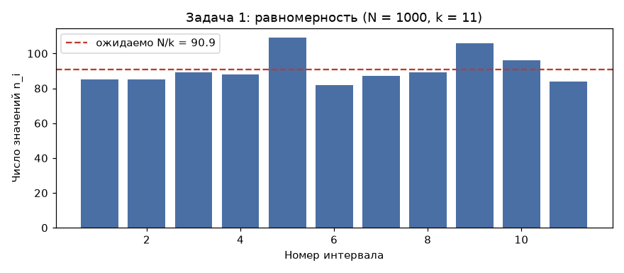

**Тест на отсутствие автокорреляции.** Коэффициент корреляции r между рядом y и рядом y* со сдвигом k; критерий Стьюдента t = r/√(1−r²)·√(N−k−2), f = N−k−2, α = 0,05 (двусторонний); по шкале Чеддока |r| < 0,3 — связь практически отсутствует.

| k | r | \|r\| < 0,3 | t | t_табл | \|t\| < t_табл |
|---|---|---|---|---|---|
| 1 | +0.0256 | да | +0.809 | 1.962 | да |
| 2 | -0.0257 | да | -0.811 | 1.962 | да |
| 3 | +0.0193 | да | +0.610 | 1.962 | да |
| 4 | +0.0409 | да | +1.290 | 1.962 | да |
| 5 | +0.0336 | да | +1.060 | 1.962 | да |
| 6 | -0.0175 | да | -0.550 | 1.962 | да |
| 7 | -0.0275 | да | -0.866 | 1.962 | да |
| 8 | -0.0815 | да | -2.572 | 1.962 | нет |
| 9 | +0.0105 | да | +0.329 | 1.962 | да |
| 10 | +0.0130 | да | +0.409 | 1.962 | да |

Вывод по автокорреляции: по шкале Чеддока модуль r меньше 0,3 для всех сдвигов (максимум 0.081), т.е. связь практически отсутствует. По критерию Стьюдента формально значим только k = 8 (r = -0.081, t = -2.57). При 10 проверках на уровне α = 0,05 ожидаемое число ложных срабатываний ≈ 0.5, а такое |r| ничтожно мало, поэтому ГПСЧ признаём прошедшим тест (практически значимой автокорреляции нет).

### Задача 2. Линейный конгруэнтный метод

X_(k+1) = (a·X_k + c) mod m, **a = 843314861**, **c = 453816693**, **m = 2³² = 4294967296**, X₀ = **3141592653** (10 различных цифр, X₀ < m). Длина последовательности 100, нормировка X_k / m.

Условия максимального периода (теорема Халла — Добелла) для m = 2³²: c нечётно (да) и a − 1 делится на 4 (да) → период равен m = 2³², в первых 100 числах повторов нет.

Первые 10 значений:

| k | X_k | X_k / m |
|---|---|---|
| 1 | 1398624638 | 0.325643 |
| 2 | 224778139 | 0.052335 |
| 3 | 3114227508 | 0.725088 |
| 4 | 2753730457 | 0.641153 |
| 5 | 3542428122 | 0.824786 |
| 6 | 158299591 | 0.036857 |
| 7 | 1201767152 | 0.279808 |
| 8 | 3688156581 | 0.858716 |
| 9 | 866596854 | 0.201770 |
| 10 | 1681254067 | 0.391447 |

**Объём выборки** N = 100; значения нормированы в [0; 1).

**Отрезок апериодичности.** Пары подряд идущих значений не повторяются на всей длине выборки (цикл не обнаружен). Одинаковые значения вообще не встретились. 

**Тест на равномерность** (χ², α = 0,05). Число интервалов по Стёрджесу k = 1 + round(log₂ 100) = **8**, f = k − 1 = 7.

| Интервал | 0.000–0.125 | 0.125–0.250 | 0.250–0.375 | 0.375–0.500 | 0.500–0.625 | 0.625–0.750 | 0.750–0.875 | 0.875–1.000 |
|---|---|---|---|---|---|---|---|---|
| n_i | 10 | 13 | 12 | 13 | 13 | 10 | 18 | 11 |

χ² = **3.680**, табличное χ²₀,₀₅(7) = **14.067**. χ² меньше табличного → распределение достаточно равномерное.

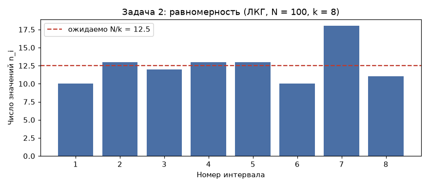

**Тест на отсутствие автокорреляции.** Коэффициент корреляции r между рядом y и рядом y* со сдвигом k; критерий Стьюдента t = r/√(1−r²)·√(N−k−2), f = N−k−2, α = 0,05 (двусторонний); по шкале Чеддока |r| < 0,3 — связь практически отсутствует.

| k | r | \|r\| < 0,3 | t | t_табл | \|t\| < t_табл |
|---|---|---|---|---|---|
| 1 | -0.0474 | да | -0.467 | 1.985 | да |
| 2 | -0.1852 | да | -1.847 | 1.985 | да |
| 3 | -0.0405 | да | -0.395 | 1.985 | да |
| 4 | +0.0506 | да | +0.491 | 1.986 | да |
| 5 | +0.0194 | да | +0.187 | 1.986 | да |
| 10 | -0.0754 | да | -0.710 | 1.987 | да |
| 20 | +0.0404 | да | +0.357 | 1.991 | да |
| 30 | +0.1368 | да | +1.139 | 1.995 | да |
| 50 | -0.0594 | да | -0.412 | 2.011 | да |

Вывод по автокорреляции: для всех проверенных сдвигов связь незначима, автокорреляция отсутствует .


### Задача 3. Тест Казиски: длина ключа шифра Виженера

Порог индекса совпадения для русского языка 0,053; для случайного текста ≤ 0,038 (для t = 1 ожидаемо ≈ 1/33 = 0,030).

| t (шаг) | Длина подпоследовательности | Ic | Вывод |
|---|---|---|---|
| 1 | 1033 | 0.0346 | ≈ случайный текст, идём дальше |
| 2 | 517 | 0.0429 | ≈ случайный текст, идём дальше |
| 3 | 345 | 0.0371 | ≈ случайный текст, идём дальше |
| 4 | 259 | 0.0618 | ≥ 0,053 → длина ключа t |
| 5 | 207 | 0.0418 | ≈ случайный текст, идём дальше |
| 6 | 173 | 0.0456 | между порогами, идём дальше |
| 7 | 148 | 0.0391 | ≈ случайный текст, идём дальше |
| 8 | 130 | 0.0683 | ≥ 0,053 → длина ключа t |
| 9 | 115 | 0.0430 | ≈ случайный текст, идём дальше |
| 10 | 104 | 0.0571 | ≥ 0,053 → длина ключа t |
| 11 | 94 | 0.0403 | ≈ случайный текст, идём дальше |
| 12 | 87 | 0.0760 | ≥ 0,053 → длина ключа t |

Первое значение t, при котором Ic ≥ 0,053 — **t = 4** (Ic = 0.0618). Для кратных t индекс тоже высок (t = 16: 0.073, t = 20: 0.095, t = 24: 0.100, t = 28: 0.075, t = 32: 0.078) — как и положено, если длина ключа равна 4 или кратна ему.

**Ответ: длина ключа = 4.**

Проверка: для каждого из 4 столбцов (c_i, c_(i+4), …) подобран сдвиг по частотам русского языка → ключ `ключ`. Расшифровка (первые 120 букв): `какростовщикхотелженитсянамолоденькойдевушкеатараскрылаегообманодинмелкийлавочникзадолжалростовщикукрупнуюсуммуденегрост…` — осмысленный русский текст, длина ключа подтверждена.

### Задача 4 (творческая). Шифрование текстом на ГПСЧ фон Неймана

Текст «Ключи от сейфа под ковриком».

**1. Подготовка текста.** Приводим к нижнему регистру, удаляем пробелы и знаки → `ключиотсейфаподковриком` (23 буквы); буквы заменяем числами 0…32 (а=0, …, я=32).

**2. Идея обратимости.** Сам метод середин квадратов необратим (разные R дают одну середину; по R_(k+1) нельзя однозначно найти R_k), поэтому «обратную функцию ГПСЧ» строим не для генератора, а для шифра — это **гаммирование**. Секретный ключ — начальное число R₀ = 1516. Отправитель и получатель независимо запускают один и тот же детерминированный ГПСЧ и получают одну гамму γ_i = R_i mod 33:

- шифрование: c_i = (p_i + γ_i) mod 33;
- расшифрование: p_i = (c_i − γ_i) mod 33 (обратная операция — вычитание той же гаммы).

R_(i+1) = средние 4 цифры от R_i² (восьмизначной, с ведущими нулями).

| i | Буква | p_i | R_i | γ_i | c_i (число) | Шифр |
|---|---|---|---|---|---|---|
| 1 | к | 11 | 2982 | 2982 mod 33 = 12 | 23 | ц |
| 2 | л | 12 | 8923 | 8923 mod 33 = 13 | 25 | ш |
| 3 | ю | 31 | 6199 | 6199 mod 33 = 28 | 26 | щ |
| 4 | ч | 24 | 4276 | 4276 mod 33 = 19 | 10 | й |
| 5 | и | 9 | 2841 | 2841 mod 33 = 3 | 12 | л |
| 6 | о | 15 | 712 | 0712 mod 33 = 19 | 1 | б |
| 7 | т | 19 | 5069 | 5069 mod 33 = 20 | 6 | ё |
| 8 | с | 18 | 6947 | 6947 mod 33 = 17 | 2 | в |
| 9 | е | 5 | 2608 | 2608 mod 33 = 1 | 6 | ё |
| 10 | й | 10 | 8016 | 8016 mod 33 = 30 | 7 | ж |
| 11 | ф | 21 | 2562 | 2562 mod 33 = 21 | 9 | и |
| 12 | а | 0 | 5638 | 5638 mod 33 = 28 | 28 | ы |
| 13 | п | 16 | 7870 | 7870 mod 33 = 16 | 32 | я |
| 14 | о | 15 | 9369 | 9369 mod 33 = 30 | 12 | л |
| 15 | д | 4 | 7781 | 7781 mod 33 = 26 | 30 | э |
| 16 | к | 11 | 5439 | 5439 mod 33 = 27 | 5 | е |
| 17 | о | 15 | 5827 | 5827 mod 33 = 19 | 1 | б |
| 18 | в | 2 | 9539 | 9539 mod 33 = 2 | 4 | д |
| 19 | р | 17 | 9925 | 9925 mod 33 = 25 | 9 | и |
| 20 | и | 9 | 5056 | 5056 mod 33 = 7 | 16 | п |
| 21 | к | 11 | 5631 | 5631 mod 33 = 21 | 32 | я |
| 22 | о | 15 | 7081 | 7081 mod 33 = 19 | 1 | б |
| 23 | м | 13 | 1405 | 1405 mod 33 = 19 | 32 | я |

**Шифротекст:** `ЦШЩЙЛБЁВЁЖИЫЯЛЭЕБДИПЯБЯ`

Расшифровка тем же R₀ = 1516 возвращает `ключиотсейфаподковриком`

**Вариант на методе произведений** (ядро 1516, начальное множимое 1515; число = 4 средние цифры произведения, новое множимое — 4 последние цифры): гамма [30, 0, 10, 28, 27, 22, 31, 20, 5, 4, 0, 8, 30, 15, 14, 25, 1, 7, 8, 24, 2, 11, 0], шифротекст `ЗЛЗТГДРЕЙНФЗМЭСГПИШАМЩМ`; расшифровывается так же.

**Слабые места (оценка стойкости):** ГПСЧ фон Неймана вырождается (может зациклиться или дойти до 0 при неудачном R₀) и не криптостоек: состояние генератора = его выход, поэтому при известном куске открытого текста γ = c − p даёт значения R_i, из которых вычисляется вся дальнейшая гамма. Гамму нельзя использовать повторно для разных сообщений. Для реальной защиты нужен криптостойкий ГПСЧ (блочный шифр в режиме счётчика, поточный шифр, хеш-функция).


# Практическое занятие 3. Арифметика остатков в криптографии


## Задача 1. Остаток деления

- 15 mod 4: 15 = 3·4 + **3** → **3**.
- −17 mod 3: −17 = −6·3 + **1** → **1**

## Задача 2. Разность и произведение сравнений

Пусть a ≡ b (mod m), c ≡ d (mod m): a = km + r, b = nm + r, c = Lm + r₁, d = pm + r₁ (одинаковые остатки r и r₁).

- **Разность:** a − c = (k − L)m + (r − r₁), b − d = (n − p)m + (r − r₁). Первые слагаемые делятся на m, поэтому (a − c) mod m = (r − r₁) mod m = (b − d) mod m. 
- **Произведение:** ac = (km + r)(Lm + r₁) = m·(kLm + kr₁ + rL) + rr₁, bd = (nm + r)(pm + r₁) = m·(npm + nr₁ + rp) + rr₁. Значит (ac) mod m = (rr₁) mod m = (bd) mod m.

## Задача 3. a ≡ b (mod m) ⇒ aᵏ ≡ bᵏ (mod m)

База индукции k = 1 — условие. Шаг: пусть aᵏ ≡ bᵏ. Так как a ≡ b, по свойству 6 (произведение сравнений, задача 2) aᵏ·a ≡ bᵏ·b, т.е. aᵏ⁺¹ ≡ bᵏ⁺¹ (mod m).

## Задача 4. a − 2b ⋮ m и c − 3d ⋮ m ⇒ ac − 6bd ⋮ m

Из условия a ≡ 2b, c ≡ 3d (mod m), по свойству произведения ac ≡ 2b·3d = 6bd (mod m), то есть m | (ac − 6bd).

Прямое разложение: a − 2b = ms, c − 3d = mt ⇒ ac − 6bd = (a − 2b)c + 2b(c − 3d) = m(sc + 2bt) ⋮ m.

## Задача 5. Остатки степеней

**2²⁰¹⁸ mod 17.** 2⁴ (mod 17) = 16 (mod 17) ≡ −1 (mod 17), значит 2⁸ (mod 17) ≡ 1 (mod 17). 2018 = 8·252 + 2, поэтому 2²⁰¹⁸ = (2⁸)²⁵² · 2² ≡ 1·4 = **4**.

## Задача 6. Признаки делимости

Число N = aₖ·10ᵏ + … + a₁·10 + a₀ (aᵢ — цифры). Модуль m, остаток 10 по модулю m определяет признак.

- **На 9 и на 3.** 10 (mod 9) и (mod 3) ≡ 1 (mod 9) и (mod 3) ⇒ 10ⁱ ≡ 1 ⇒ N ≡ aₖ + … + a₀. **N ⋮ 9 (3) ⇔ сумма цифр ⋮ 9 (3)** (для 3 — потому что 10 = 9 + 1 ≡ 1 и по модулю 3).
- **На 5.** 10(mod 5) ≡ 0 (mod 5) ⇒ 10ⁱ ≡ 0 при i ≥ 1 ⇒ N ≡ a₀. **N ⋮ 5 ⇔ последняя цифра 0 или 5.**
- **На 11.** 10 (mod 11)≡ −1 (mod 11) ⇒ 10ⁱ ≡ (−1)ⁱ ⇒ N ≡ a₀ − a₁ + a₂ − … **N ⋮ 11 ⇔ знакопеременная сумма цифр (справа налево) ⋮ 11.**


## Задача 7. Доказательство делимости

1. **13ⁿ + 3ⁿ⁺² ⋮ 10** 13 ≡ 3 (mod 10), поэтому 13ⁿ + 3ⁿ⁺² ≡ 3ⁿ + 9·3ⁿ = 10·3ⁿ ≡ 0 (mod 10).
2. **3·5²ⁿ⁺¹ + 2³ⁿ⁺¹ ⋮ 17.** 5²ⁿ⁺¹ = 5·25ⁿ, 2³ⁿ⁺¹ = 2·8ⁿ; 25 ≡ 8 (mod 17). Тогда выражение ≡ 15·8ⁿ + 2·8ⁿ = 17·8ⁿ ≡ 0 (mod 17).
3. **7ⁿ⁺² + 8²ⁿ⁺¹ ⋮ 57.** 8²ⁿ⁺¹ = 8·64ⁿ, 64 ≡ 7 (mod 57). Тогда выражение ≡ 49·7ⁿ + 8·7ⁿ = 57·7ⁿ ≡ 0 (mod 57).
4. **(2ⁿ − 1)ⁿ − 3 ⋮ 2ⁿ − 3**. Модуль m = 2ⁿ − 3: 2ⁿ ≡ 3, поэтому 2ⁿ − 1 ≡ 2 и (2ⁿ − 1)ⁿ ≡ 2ⁿ ≡ 3 (mod m). Значит (2ⁿ − 1)ⁿ − 3 ≡ 0 (mod 2ⁿ − 3).


## Задача 8. Малая теорема Ферма

1. **n⁵ − n ⋮ 5.** Перебор остатков n по модулю 5:

| n mod 5 | 0 | 1 | 2 | 3 | 4 |
|---|---|---|---|---|---|
| n⁵ mod 5 | 0 | 1 | 2 | 3 | 4 |
| n⁵ − n mod 5 | 0 | 0 | 0 | 0 | 0 |

   В последней строке везде 0 (n⁵ ≡ n). Тот же результат даёт МТФ при p = 5: n⁵ ≡ n (mod 5).

2. **n⁹ − n ⋮ 9 — утверждение, как оно записано, неверно.** Контрпримеры: n = 2: 2⁹ − 2 = 510 = 9·56 + 6; n = 3: 3⁹ − 3 = 19680 = 9·2186 + 6.
   
## Задача 9. Многочлен и сравнения

Пусть P(x) = aₙxⁿ + … + a₁x + a₀, aᵢ ∈ ℤ, x ≡ y (mod m).

1. По задаче 3: xᵏ ≡ yᵏ (mod m) для каждого k = 0, 1, …, n.
2. Умножая на целое aₖ : aₖxᵏ ≡ aₖyᵏ.
3. Складывая n + 1 сравнение: P(x) = Σaₖxᵏ ≡ Σaₖyᵏ = P(y) (mod m).

Пусть aᵢ ≡ bᵢ (mod m) и x ≡ y. Тогда xⁱ ≡ yⁱ, и aᵢxⁱ ≡ bᵢyⁱ. Складывая: P(x) = Σaᵢxⁱ ≡ Σbᵢyⁱ = P(y) (mod m).

## Задача 10. День недели по дате

Использована формула Целлера (модульная арифметика, 0 = воскресенье, 1 = понедельник, ... , 6 = суббота):

w ≡ d + ⌊(13m − 1)/5⌋ + g + ⌊g/4⌋ + ⌊c/4⌋ − 2c (mod 7),

где d — число, месяц m нумеруется с марта (март = 3, апрель = 4, ... , февраль = 14, если месяца январь или февраль, то год берётся предыдущий), Y — этот скорректированный год, c = ⌊Y/100⌋, g = Y mod 100. Идея: 7 дней в неделе, поэтому важен лишь остаток от деления числа дней, прошедших от опорной даты, на 7; смещение месяцев даёт ⌊(13m − 1)/5⌋, високосные годы — ⌊g/4⌋ и ⌊c/4⌋.

| Дата | Параметры | w | День недели |
|---|---|---|---|
| 08.11.2026 | m=9, Y=2026, c=20, g=26 | 0 | воскресенье |
| 01.01.2000 | m=11, Y=1999, c=19, g=99 | 6 | суббота |
| 12.04.1961 | m=2, Y=1961, c=19, g=61 | 3 | среда |
| 29.02.2024 | m=12, Y=2023, c=20, g=23 | 4 | четверг |


## Модулярная арифметика в криптографии

### Задача 11. Шифр Цезаря: «Hello world!»

Cᵢ = (Mᵢ + 15) mod 24

| № | Mᵢ | номер | (номер + 15) mod 24 | Cᵢ |
|---|---|---|---|---|
| 1 | H | 7 | 22 | Y |
| 2 | E | 4 | 19 | V |
| 3 | L | 10 | 1 | B |
| 4 | L | 10 | 1 | B |
| 5 | O | 13 | 4 | E |
| 6 | W | 20 | 11 | M |
| 7 | O | 13 | 4 | E |
| 8 | R | 16 | 7 | H |
| 9 | L | 10 | 1 | B |
| 10 | D | 3 | 18 | T |

**Шифротекст: `YVBBE MEHBT!`** (расшифровка Mᵢ = (Cᵢ − 15) mod 24)

### Задача 12. Формула шифра Виженера через шифр Цезаря

Шифр Цезаря: Cᵢ = (Mᵢ + key) mod N. Шифр Виженера — тот же Цезарь, но ключ меняется от буквы к букве по повторяющемуся слову-ключу K = k₀k₁…k_(L−1) длины L:

**Cᵢ = (Mᵢ + k_i (mod L)) mod N**, расшифрование **Mᵢ = (Cᵢ − k_i (mod L)) mod N.**

То есть i-я буква шифруется шифром Цезаря с ключом key = k_i (mod L); при L = 1 получается обычный Цезарь

### Задача 13. Схема Диффи — Хеллмана

#### Часть 1. Функция 5ˣ mod 983

**Проверка параметров.** P = 983 — простое; (P − 1)/2 = 491 — простое (значит, P — «безопасное» простое); a = 5 — первообразный корень: порядок a делит P − 1 = 2·491, а 5² mod 983 = 25 ≠ 1 и 5⁴⁹¹ mod 983 = 982 ≠ 1, поэтому порядок равен 982, и числа 5ˣ, x = 1…982, пробегают все значения 1…982

| Шаг | Алиса | Боб |
|---|---|---|
| Секретный ключ | A = 356 | B = 164 |
| Открытый ключ | α = 5^356 mod 983 = 385 | β = 5^164 mod 983 = 130 |
| Обмен по открытому каналу | получает β = 130 | получает α = 385 |
| Общий ключ | βᴬ mod 983 = 619 | αᴮ mod 983 = 619 |

**Общий секретный ключ K = 619** (у обоих совпал: (aᴮ)ᴬ = (aᴬ)ᴮ = aᴬᴮ mod P).

**Шифр Вернама (XOR).** Фраза от преподавателя не указана, поэтому взята `HELLO` из примера методички; символы кодируются 7-битным ASCII. Ключ - 35 бит гаммы
| Буква | ASCII (DEC) | Биты открытого текста | Биты ключа | XOR = шифр | Символ |
|---|---|---|---|---|---|
| H | 72 | 1001000 | 0010000 | 1011000 | X |
| E | 69 | 1000101 | 0001001 | 1001100 | L |
| L | 76 | 1001100 | 1101101 | 0100001 | ! |
| L | 76 | 1001100 | 1000001 | 0001101 | · |
| O | 79 | 1001111 | 1110011 | 0111100 | < |

- Открытый текст: `10010001000101100110010011001001111`
- Ключ:           `00100000001001110110110000011110011`
- XOR (шифртекст): `10110001001100010000100011010111100`

**Расшифрование** (Боб, свой ключ K = 619, тот же XOR): `10110001001100010000100011010111100` XOR `00100000001001110110110000011110011` = `10010001000101100110010011001001111` → **HELLO**

#### Часть 2. Собственная функция aˣ mod P

Требования: P и (P − 1)/2 — простые; a — первообразный корень по модулю P. Алгоритм: перебирать p, пока p и q = (p − 1)/2 оба простые; затем g — первообразный корень, если g² ≢ 1 и gᵠ ≢ 1 (mod p) (порядок g делит 2q и не равен 1, 2, q, значит, равен 2q = p − 1).

- Первое такое простое выше 1000: **P = 1019**, q = (P − 1)/2 = **509** (оба простые).
- Число первообразных корней φ(P − 1) = φ(2q) = q − 1 = **508**; наименьший: **a = 2**.
- **Функция Диффи — Хеллмана: F(x) = 2ˣ mod 1019** 
Первые значения: 2^1 = 2, 2^2 = 4, 2^3 = 8, 2^4 = 16, 2^5 = 32, 2^6 = 64, 2^7 = 128, 2^8 = 256, …

Пример обмена: A = 361, B = 468 → α = 766, β = 472, общий ключ K = 75 (одинаков у обеих сторон).

## Теоретические вопросы

1. **Односторонняя функция.** Определение: функция F называется односторонней, если F(x) вычисляется эффективно (за полиномиальное время), но для любого полиномиального вероятностного алгоритма A вероятность найти прообраз P(A(F(x)) = x) меньше пренебрежимо малой ϵ(n) для случайного x ∈ {0,1}ⁿ. Своими словами: считать «вперёд» легко, «назад» — практически невозможно.
2. **Задача схемы Диффи — Хеллмана.** Она решает проблему **распределения ключей**: два абонента, не имеющие общего секрета заранее, по открытому каналу получают одинаковый секретный ключ, не передавая его. Затем ключ используется в симметричном шифре. Сама схема даёт конфиденциальность ключа от пассивного наблюдателя, но не аутентификацию сторон.
3. **Почему злоумышленник не подберёт ключ.** По открытому каналу видны лишь P, a, α = aᴬ mod P и β = aᴮ mod P. Чтобы получить K = aᴬᴮ mod P, нужен A или B, т.е. дискретный логарифм: найти x по aˣ mod P — вычислительно трудная задача (для больших P, ≥ 2048 бит, неосуществима за разумное время; перебор A занимает до P − 1 шагов). Вычисление aᴬᴮ только по α и β — проблема Диффи — Хеллмана, считается столь же трудной. Уязвимость схемы — активная атака «человек посередине» (злоумышленник подменяет α и β), поэтому открытые ключи надо аутентифицировать.


# Практическое занятие 4. Модулярная арифметика и асимметричное шифрование (RSA)


## Задание 1. Z₁₁ и Z₈: обратимые элементы

Обратный к a элемент a⁻¹ — такой, что a·a⁻¹ ≡ 1 (mod n). Как и в примере с Z₇, строим таблицы умножения остатков.

### 1. Z₁₁

**Z11 = {0, 1, 2, 3, 4, 5, 6, 7, 8, 9, 10}** (11 элементов).

Таблица умножения остатков по модулю 11:

| × | 1 | 2 | 3 | 4 | 5 | 6 | 7 | 8 | 9 | 10 |
|---|---|---|---|---|---|---|---|---|---|---|
| 1 | 1 | 2 | 3 | 4 | 5 | 6 | 7 | 8 | 9 | 10 |
| 2 | 2 | 4 | 6 | 8 | 10 | 1 | 3 | 5 | 7 | 9 |
| 3 | 3 | 6 | 9 | 1 | 4 | 7 | 10 | 2 | 5 | 8 |
| 4 | 4 | 8 | 1 | 5 | 9 | 2 | 6 | 10 | 3 | 7 |
| 5 | 5 | 10 | 4 | 9 | 3 | 8 | 2 | 7 | 1 | 6 |
| 6 | 6 | 1 | 7 | 2 | 8 | 3 | 9 | 4 | 10 | 5 |
| 7 | 7 | 3 | 10 | 6 | 2 | 9 | 5 | 1 | 8 | 4 |
| 8 | 8 | 5 | 2 | 10 | 7 | 4 | 1 | 9 | 6 | 3 |
| 9 | 9 | 7 | 5 | 3 | 1 | 10 | 8 | 6 | 4 | 2 |
| 10 | 10 | 9 | 8 | 7 | 6 | 5 | 4 | 3 | 2 | 1 |

- Обратимые элементы: **1, 2, 3, 4, 5, 6, 7, 8, 9, 10** (10 шт.).
- Обратные: **1 ↔ 1, 2 ↔ 6, 3 ↔ 4, 4 ↔ 3, 5 ↔ 9, 6 ↔ 2, 7 ↔ 8, 8 ↔ 7, 9 ↔ 5, 10 ↔ 10**.
- Необратимых ненулевых элементов нет.

### 2. Z₈

**Z8 = {0, 1, 2, 3, 4, 5, 6, 7}** (8 элементов).

Таблица умножения остатков по модулю 8:

| × | 1 | 2 | 3 | 4 | 5 | 6 | 7 |
|---|---|---|---|---|---|---|---|
| 1 | 1 | 2 | 3 | 4 | 5 | 6 | 7 |
| 2 | 2 | 4 | 6 | 0 | 2 | 4 | 6 |
| 3 | 3 | 6 | 1 | 4 | 7 | 2 | 5 |
| 4 | 4 | 0 | 4 | 0 | 4 | 0 | 4 |
| 5 | 5 | 2 | 7 | 4 | 1 | 6 | 3 |
| 6 | 6 | 4 | 2 | 0 | 6 | 4 | 2 |
| 7 | 7 | 6 | 5 | 4 | 3 | 2 | 1 |

- Обратимые элементы: **1, 3, 5, 7** (4 шт.).
- Обратные: **1 ↔ 1, 3 ↔ 3, 5 ↔ 5, 7 ↔ 7**.
- Необратимые ненулевые элементы: **2, 4, 6**

### 3. Сравнение и выводы

| | Z₁₁ (модуль простой) | Z₈ (модуль составной) |
|---|---|---|
| Обратимые элементы | все ненулевые: 1…10 (10 шт. = 11 − 1) | только 1, 3, 5, 7 (4 шт. = φ(8)) |
| Необратимые ненулевые | нет | 2, 4, 6 |
| Обратные | 1↔1, 2↔6, 3↔4, 5↔9, 7↔8, 10↔10 | каждый сам себе обратный: 1·1 = 3·3 = 5·5 = 7·7 ≡ 1 (mod 8) |
| Таблица умножения | в каждой строке и столбце единица встречается ровно один раз, значения в строке не повторяются | в строках 2, 4, 6 нет единицы, есть нули (2·4 ≡ 0) и повторы значений |

**Выводы:**

- По **простому** модулю p каждый ненулевой элемент обратим (НОД(a, p) = 1 для всех 1 ≤ a < p), поэтому ненулевые вычеты образуют группу порядка p − 1, а Zₚ — поле: на любой ненулевой элемент можно делить, произведение двух ненулевых элементов не бывает нулём.
- По **составному** модулю n обратимы лишь элементы, взаимно простые с n; их ровно φ(n) (для 8: φ(8) = 4). Остальные необратимы и являются делителями нуля (2·4 ≡ 0, 4·4 ≡ 0, 6·4 ≡ 0 (mod 8)); из a·x ≡ a·y нельзя сократить на a.


## Задание 2. Расширенный алгоритм Евклида — НОД


Самостоятельная работа (по формуле НОД(A, B) = НОД(B, A mod B)):

НОД(108, 27):

108 mod 27 = 0


**Ответ: НОД(108, 27) = 27.**

НОД(78, 16):

78 mod 16 = 14
16 mod 14 = 2
14 mod 2 = 0

**Ответ: НОД(78, 16) = 2.**


## Задание 3. Диофантовы уравнения (множители Безу)

Таблица строится сверху вниз (A mod B и [A/B]), затем снизу вверх: в последней строке x = 0, y = 1, далее xᵢ = yᵢ₊₁, yᵢ = xᵢ₊₁ − yᵢ₊₁·[A/B]ᵢ. Ответ — x, y из первой строки.

### 1. 65·x + 102·y = 1

| i | A | B | A mod B | [A/B] | x | y |
|---|---|---|---|---|---|---|
| 0 | 65 | 102 | 65 | 0 | 11 | -7 |
| 1 | 102 | 65 | 37 | 1 | -7 | 11 |
| 2 | 65 | 37 | 28 | 1 | 4 | -7 |
| 3 | 37 | 28 | 9 | 1 | -3 | 4 |
| 4 | 28 | 9 | 1 | 3 | 1 | -3 |
| 5 | 9 | 1 | 0 | 9 | 0 | 1 |

Ответ: **x = 11, y = -7**. Проверка: 65·(11) + 102·(-7) = 715 + -714 = 1. Общее решение: x = 11 + 102·k, y = -7 − 65·k, k ∈ ℤ.

### 2. 12·x + 17·y = 1

| i | A | B | A mod B | [A/B] | x | y |
|---|---|---|---|---|---|---|
| 0 | 12 | 17 | 12 | 0 | -7 | 5 |
| 1 | 17 | 12 | 5 | 1 | 5 | -7 |
| 2 | 12 | 5 | 2 | 2 | -2 | 5 |
| 3 | 5 | 2 | 1 | 2 | 1 | -2 |
| 4 | 2 | 1 | 0 | 2 | 0 | 1 |

Ответ: **x = -7, y = 5**. Проверка: 12·(-7) + 17·(5) = -84 + 85 = 1. Общее решение: x = -7 + 17·k, y = 5 − 12·k, k ∈ ℤ.

## Задание 4. Обратный элемент: e = 17 по модулю φ(n) = 60

Ищем d: 17·d ≡ 1 (mod 60). Берём A = φ(n) = 60, B = e = 17, решаем 60·x + 17·y = 1:

| i | A | B | A mod B | [A/B] | x | y |
|---|---|---|---|---|---|---|
| 0 | 60 | 17 | 9 | 3 | 2 | -7 |
| 1 | 17 | 9 | 8 | 1 | -1 | 2 |
| 2 | 9 | 8 | 1 | 1 | 1 | -1 |
| 3 | 8 | 1 | 0 | 8 | 0 | 1 |

Получили x = 2, y = -7: 60·(2) + 17·(-7) = 1. Тогда

**d = y mod φ(n) = -7 mod 60 = 53.**

Проверка: 17·53 mod 60 = 901 mod 60 = **1**.

## Задание 5. Шифрование RSA

### Генерация ключей

1. Простые числа: **p = 47, q = 59**.
2. Модуль: **n = p·q = 2773**.
3. Функция Эйлера: **φ(n) = (p − 1)(q − 1) = 46·58 = 2668**.
4. Открытая экспонента: **e = 17** (одно из рекомендуемых значений); проверка: НОД(φ(n), e) = НОД(2668, 17) = **1**.
5. Секретная экспонента d из e·d ≡ 1 (mod φ(n)): решаем 2668·x + 17·y = 1:

| i | A | B | A mod B | [A/B] | x | y |
|---|---|---|---|---|---|---|
| 0 | 2668 | 17 | 16 | 156 | -1 | 157 |
| 1 | 17 | 16 | 1 | 1 | 1 | -1 |
| 2 | 16 | 1 | 0 | 16 | 0 | 1 |

x = -1, y = 157 ⇒ **d = 157 mod 2668 = 157**. Проверка: 17·157 mod 2668 = 2669 mod 2668 = **1**.

**Открытый ключ: (e, n) = (17, 2773). Секретный ключ: (d, p, q) = (157, 47, 59).**

### Шифрование и расшифрование

Сообщение: **«Майя»**. Кодируем символы кодами CP1251: М = 204, а = 224, й = 233, я = 255.

Шифрование: C = m^17 mod 2773; расшифрование: m = C^157 mod 2773.

| Символ | m | C = m^17 mod 2773 | C^157 mod 2773 | Символ |
|---|---|---|---|---|
| М | 204 | 2139 | 204 | М |
| а | 224 | 1847 | 224 | а |
| й | 233 | 1515 | 233 | й |
| я | 255 | 1731 | 255 | я |

Шифротекст: **2139 1847 1515 1731**.


# Практическое занятие 5. Разделение секрета: схемы Блекли, Шамира и на основе китайской теоремы об остатках


## Китайская теорема об остатках

### Задача 1. Доказательство

**Теорема.** Если n₁, …, nₖ попарно взаимно просты, то система x ≡ bᵢ (mod nᵢ) имеет решение, и любое y ≡ x (mod N), N = n₁·…·nₖ, тоже является решением.

**Доказательство**

1. Положим N = n₁·…·nₖ и Nᵢ = N / nᵢ. Так как числа nⱼ попарно просты, НОД(Nᵢ, nᵢ) = 1, поэтому существует Mᵢ = Nᵢ⁻¹ (mod nᵢ) (расширенный алгоритм Евклида), то есть Nᵢ·Mᵢ ≡ 1 (mod nᵢ).
2. Положим x = Σ bᵢ·Nᵢ·Mᵢ.
3. Проверим i-е сравнение. Для j ≠ i число Nⱼ делится на nᵢ (nᵢ входит в произведение Nⱼ), поэтому слагаемые bⱼNⱼMⱼ ≡ 0 (mod nᵢ). Остаётся слагаемое bᵢNᵢMᵢ ≡ bᵢ·1 = bᵢ (mod nᵢ). Значит x ≡ bᵢ (mod nᵢ) для всех i — решение существует.
4. Если x и y — два решения, то x − y делится на каждое nᵢ, а они попарно просты, значит x − y делится на N, то есть решение единственно по модулю N. Любое y = x + tN — тоже решение.


### Задача 2. x ≡ 5 (mod 11), x ≡ 4 (mod 13), x ≡ 3 (mod 24)

Модули 11, 13, 24 попарно просты, N = 11·13·24 = **3432**.

| nᵢ | bᵢ | Nᵢ = N/nᵢ | Nᵢ mod nᵢ | Mᵢ = Nᵢ⁻¹ mod nᵢ | bᵢ·Nᵢ·Mᵢ |
|---|---|---|---|---|---|
| 11 | 5 | 312 | 312 mod 11 = 4 | 3 | 4680 |
| 13 | 4 | 264 | 264 mod 13 = 4 | 10 | 10560 |
| 24 | 3 | 143 | 143 mod 24 = 23 | 23 | 9867 |

x = Σ bᵢNᵢMᵢ = 25107 ≡ **1083** (mod 3432).

Проверка: 1083 mod 11 = 5, 1083 mod 13 = 4, 1083 mod 24 = 3.

**Ответ:** x = 1083 + 3432·t, t ∈ ℤ (наименьшее неотрицательное решение — 1083).

### Задача 3. x ≡ 1 (mod 15), x ≡ 3 (mod 17), x ≡ 3 (mod 24), x ≡ 4 (mod 19)

Теорема в прежней форме неприменима: НОД(15, 24) = 3 ≠ 1. Для несоставных модулей сравнения совместны, только если согласованы на общих делителях. Здесь:

- x ≡ 1 (mod 15) ⇒ x ≡ 1 (mod 3);
- x ≡ 3 (mod 24) ⇒ x ≡ 0 (mod 3).

Получили x ≡ 1 и x ≡ 0 (mod 3) одновременно — противоречие. **Решения нет**

## Разделение секрета

### Задача 4. Аддитивное разделение K = 39027 (16 бит), модуль 2¹⁶ = 65536

Участников четверо. Дилер выбирает три случайные 16-битовые строки и вычисляет последнюю долю так, чтобы сумма была равна K:

- S₁ = 27391, S₂ = 1527, S₃ = 4741;
- S₄ = K − S₁ − S₂ − S₃ (mod 2¹⁶) = **5368**.

Восстановление: S₁ + S₂ + S₃ + S₄ = 39027 ≡ 39027 (mod 65536) — **K = 39027**.


### Задача 5. Схема Блекли (5, 5), M = 11, p = 23

**Подготовка.** Секретная точка Q = (11, 6, 8, 1, 2); первая координата — секрет M = 11.

**Раздача.** Для каждого участника выбраны коэффициенты aᵢⱼ и вычислено bᵢ = Σ aᵢⱼ·Qⱼ mod 23:

| Участник | a₁ | a₂ | a₃ | a₄ | a₅ | bᵢ |
|---|---|---|---|---|---|---|
| P1 | 22 | 5 | 12 | 8 | 4 | 16 |
| P2 | 11 | 15 | 12 | 9 | 13 | 20 |
| P3 | 9 | 12 | 8 | 7 | 12 | 13 |
| P4 | 11 | 8 | 10 | 17 | 14 | 18 |
| P5 | 8 | 19 | 15 | 14 | 16 | 0 |

**Восстановление (все пятеро).** Система 5×5 над Z₂₃, решение единственное — Q = (11, 6, 8, 1, 2), **M = x₁ = 11**.

**Четыре участника (P₁–P₄).** Получается 4 уравнения с 5 неизвестными.

### Задача 6. Схема Шамира (4, 7), M = 29

Параметры: k = 4, n = 7. Простое p должно быть больше секрета и числа участников: **p = 31**.

**Раздача.** Многочлен степени k − 1 = 3: S(x) = 29 + 3x + 15x^2 + 19x^3 (mod 31), S(0) = 29. Несекретные rᵢ = 1…7:

| Участник | rᵢ | cᵢ = S(rᵢ) |
|---|---|---|
| P1 | 1 | 4 |
| P2 | 2 | 30 |
| P3 | 3 | 4 |
| P4 | 4 | 9 |
| P5 | 5 | 4 |
| P6 | 6 | 10 |
| P7 | 7 | 17 |

**Восстановление по долям 1-го, 4-го, 5-го и 6-го участников:** M = S(0) = Σ cᵢ ∏ rⱼ/(rⱼ − rᵢ) (mod 31):

- r = 1, c = 4: c·∏ rⱼ/(rⱼ − rᵢ) = 4·120/(60) ≡ **8**
- r = 4, c = 9: c·∏ rⱼ/(rⱼ − rᵢ) = 9·30/(-6) ≡ **17**
- r = 5, c = 4: c·∏ rⱼ/(rⱼ − rᵢ) = 4·24/(4) ≡ **24**
- r = 6, c = 10: c·∏ rⱼ/(rⱼ − rᵢ) = 10·20/(-10) ≡ **11**

Сумма = 60 ≡ **29** (mod 31) — секрет **M = 29** восстановлен.

### Задача 7. Схема на основе китайской теореме об остатках (4, 4), M = 29

Простые nᵢ должны лежать в интервале ⁴√29 < nᵢ ≪ ³√29, то есть 2.32 < nᵢ ≪ 3.07. В нём единственное простое — 3; четыре различных простых модуля выбрать **невозможно**.


# Практическое занятие 6. Криптографические хеш-функции

## Задание 1. Хеши имени и влияние опечаток

Имя: **Ловенецкая Майя Алексеевна**.

| Алгоритм | Длина, бит | Хеш |
|---|---|---|
| MD5 | 128 | `7b005121b709a1f4efa69f52b6c904f4` |
| SHA1 | 160 | `1f232d1ca6dc060c52fca5cc4ae87b5febd08771` |
| SHA256 | 256 | `2fa7d12c95f363da2b5e5b12b1c5eceeaabc81c4e4db2e365f8d298899fb5f29` |
| SHA512 | 512 | `bfb9bf83c990a6cab17978bc091a61588e3d3854429d56d56edecd1500eadf6faf903a617287799c23db0e656830e8bdb00d067d2e910cc8832611ad7d18dce0` |

Опечатки (SHA-1, 160 бит):

| Что изменено | Строка | SHA-1 | Отличие от исходного (бит) |
|---|---|---|---|
| исходное имя | «Ловенецкая Майя Алексеевна» | `1f232d1ca6dc060c52fca5cc4ae87b5febd08771` | — |
| Майя → Маия (перестановка букв) | «Ловенецкая Маия Алексеевна» | `e5ac320fd823dfa95a455752339ed7f99eb3c04e` | 95 из 160 (59 %) |
| Ловенецкая → Ловенецкая с «о» вместо «е»: Ловонецкая | «Ловонецкая Майя Алексеевна» | `988c60dcd996abb7df675e1bbf4f227dac82b7ed` | 89 из 160 (56 %) |
| строчная «м» вместо «М» | «Ловенецкая майя Алексеевна» | `3238b2b3e14317175411e3a4a27ddc8da1987938` | 82 из 160 (51 %) |
| лишний пробел в конце | «Ловенецкая Майя Алексеевна » | `30b93ba4352b23c66a7f3b7d3821e355581dfa53` | 80 из 160 (50 %) |
| пропущена одна буква (Алексеевна → Алексевна) | «Ловенецкая Майя Алексевна» | `e7e92918dc78ea0305e23c02d3c623bc29ce0446` | 77 из 160 (48 %) |

**Вывод.** Любая правка — перестановка двух букв, смена регистра, лишний пробел — даёт хеш, не имеющий ничего общего с исходным: в среднем меняется около 85 из 160 бит (≈ 50 %, как у случайных значений). Это лавинный эффект, длина хеша при этом постоянна.

**Как хеш-функции применяются в защите информации:**

- *хранение паролей:* в БД хранится хеш, пароль по хешу не восстановить;
- *контроль целостности:* контрольная сумма файла/образа/обновления — любое изменение видно сразу;
- *электронная подпись:* подписывается не весь документ, а его хеш;
- *идентификация данных:* дедупликация, блокчейн (хеш блока), цепочки хешей, HMAC для аутентификации сообщений, обнаружение вредоносного ПО по сигнатурам-хешам известных образцов.


## Задание 2. Хеш-функция «сумма кодов»

Фраза «Мама мыла раму»: коды символов (Unicode) — 1052 + 1072 + 1084 + 1072 + 32 + 1084 + 1099 + 1083 + 1072 + 32 + 1088 + 1072 + 1084 + 1091 = **13017**.

**Недостатки с точки зрения требований:**

- *коллизии тривиальны:* порядок символов не важен — «раму Мама мыла» даёт то же 13017; любая перестановка слов и букв даёт то же значение;
- *нет лавинного эффекта:* замена одной буквы на соседнюю по коду меняет хеш на 1;
- *легко подобрать прообраз:* для заданной суммы достаточно подобрать любые символы с нужной суммой;
- *длина хеша не фиксирована:* растёт с размером сообщения.

## Задание 3. (a₁ + … + aₙ) mod 2ⁿ

Возьмём n = 8 бит: «Мама мыла раму» → 13017 mod 256 = **217**

Длина хеша теперь фиксирована, но остальные недостатки остались, а пространство значений мало:

- по-прежнему важны только сумма, а не порядок: «Мама мыла раму» и «Рама мыла маму» → 217 и 217 (одинаковы);
- нет лавинного эффекта, прообраз подбирается тривиально.

## Задание 4. Полиномиальный хеш (a₁·P¹ + a₂·P² + … + aₙ·Pⁿ) mod 2ⁿ

Положим P = 31 (простое), n = 32 бит, Pᵢ = Pⁱ. Теперь порядок символов влияет на значение (перестановки уже не коллизии).

ФИО «Ловенецкая Майя Алексеевна»: первые слагаемые aᵢ·Pⁱ mod 2³²:

| Символ | Код aᵢ | Pⁱ mod 2³² | aᵢ·Pⁱ mod 2³² |
|---|---|---|---|
| Л | 1051 | 31 | 32581 |
| о | 1086 | 961 | 1043646 |
| в | 1074 | 29791 | 31995534 |
| е | 1077 | 923521 | 994632117 |
| н | 1085 | 28629151 | 997857763 |

Полный хеш: **3228014971** = 0xc067997b.

**Недостатки этого подхода.** Функция линейна и обратима «по частям», поэтому не является криптографической: для заданного значения прообраз находится решением линейного уравнения; пространство 2³² мало, и по парадоксу дней рождения коллизия находится примерно за 2¹⁶ попыток.

## Задание 5. Таблица ключей

| ФИО | Ключ (полиномиальная функция, P = 31, 32 бит) | Ключ (SHA-1) |
|---|---|---|
| Ловенецкая Майя Алексеевна | 3228014971 (0xc067997b) | `1f232d1ca6dc060c52fca5cc4ae87b5febd08771` |
| Корецкий Владимир Павлович | 2147080754 (0x7ff9da32) | `e1c9976155d22c6685d288cec9e2badfaa516d6f` |
| Карецкий Владимир Павлович | 2147067300 (0x7ff9a5a4) | `a8164c46e60b44bc2d8b7d3f2d60823cddfe4b0c` |
| Ловенецкая Майя | 1344012615 (0x501c0147) | `f5dcf5f2e6d14cc7ed7c7be6219450fa3aed4485` |
| Ловенецкая Маия Алексеевна | 1720463162 (0x668c2f3a) | `e5ac320fd823dfa95a455752339ed7f99eb3c04e` |

Полиномиальный ключ — 32 бита (подходит для хеш-таблицы, но не для безопасности); SHA-1 — 160 бит. Опечатка «Карецкий» меняет оба ключа, но у SHA-1 изменение абсолютно непредсказуемо, а у полиномиального хеша зависит от позиции символа предсказуемым образом.

## Задание 6. Проверка целостности файлов

| Файл | MD5 |
|---|---|
| document_original.txt | `1cbbb6eaa4362d5033c37f66018b08aa` |
| document_returned_unchanged.txt | `1cbbb6eaa4362d5033c37f66018b08aa` |
| document_returned_edited.txt | `c0939fac2ccdb9954986d72832281a63` |

Хеш оригинала и неизменённой копии совпадает, у отредактированного — полностью другой: изменение в одном символе обнаружено. 

## Задание 7. Подпись документа: RSA + SHA-512

Алгоритм: (1) генерируем ключи RSA; (2) считаем SHA-512 от документа; (3) «шифруем» хеш закрытым ключом: ЭЦП = хеш^d mod n; проверка — ЭЦП^e mod n сравнивается с заново посчитанным хешем.

- Ключ RSA 1024 бит: e = 65537; n = `e995dcf207928703f373de5d5799d42dc512baf064996be1…` (1024 бит); d = `1141fb42fe803aed75cd37be99bc49cadfe6945d32718b60…` (скрыт). p и q — простые по 512 бит.
- Документ: «Договор № 15. Сумма: 10000 руб. Исполнитель: Ловенецкая Майя Алексеевна»; SHA-512 = `d70d717f8bdc30fbda0d54aa63ac4dcd54d68f03dc055d7085816158e3d66d3bdbbc6665d987d515d99b2775fc025d5c9fbefe6f040e2abd076a88edbd528cc4`.
- ЭЦП (hex, начало): `7f90fec8b65fdde8ded23313dd5c4fd2647ac75fbea66800c8e9d2bbc1408c3bb4e8add2a74602f8530495b251cb8c6a…`
- Проверка открытым ключом: **подпись верна**.
- Подмена «10000» → «10001»: хеш меняется, проверка → **подпись не проходит**.
- Подпись с изменённым битом: проверка → **не проходит**.


## Задание 8. Контрольная сумма в PowerShell

Команда (файл `hash_work\document_original.txt`):

```
Get-FileHash "D:\Cybersecurity\hash_work\document_original.txt" -Algorithm SHA1
```

Результаты:

| Алгоритм | Get-FileHash |
|---|---|
| SHA1 | `8B5ECCEA9A28CDA83ADA08593E320C137126E879` |
| SHA256 | `44F1B1F36DC8DD9D2B9186BE356596D58874F66B484FC0FAB77E16B88B8C2D12` |
| SHA384 | `5CD2CE5B0007325DD7F47734124126824FE59BBF1FEE38F941B79620BBF0583033EAC146C10849B500055EBC2B215FF6` |
| SHA512 | `8D2B7855C6C943A64B37851B54FEEEE35FE93237AD8961B8920B44914E1E34085BAF93B6827861F52548FD5672C98DA6EE7E782ED8FE19A2AF67C3D7F5126C5D` |
| MD5 | `1CBBB6EAA4362D5033C37F66018B08AA` |

## Задание 9. Контрольная сумма командой certutil

Команда:

```
certutil -hashfile "D:\Cybersecurity\hash_work\document_original.txt" MD5
```

Результаты:

| Алгоритм | certutil -hashfile |
|---|---|
| MD5 | `1cbbb6eaa4362d5033c37f66018b08aa` |
| SHA1 | `8b5eccea9a28cda83ada08593e320c137126e879` |
| SHA256 | `44f1b1f36dc8dd9d2b9186be356596d58874f66b484fc0fab77e16b88b8c2d12` |
| SHA384 | `5cd2ce5b0007325dd7f47734124126824fe59bbf1fee38f941b79620bbf0583033eac146c10849b500055ebc2b215ff6` |
| SHA512 | `8d2b7855c6c943a64b37851b54feeee35fe93237ad8961b8920b44914e1e34085baf93b6827861f52548fd5672c98da6ee7e782ed8fe19a2af67c3d7f5126c5d` |


## Задание 10. Цифровой сертификат и подпись в Word/Excel

**1. Запуск SelfCert.exe.** Программа находится в `C:\Program Files\Microsoft Office\root\Office16`.

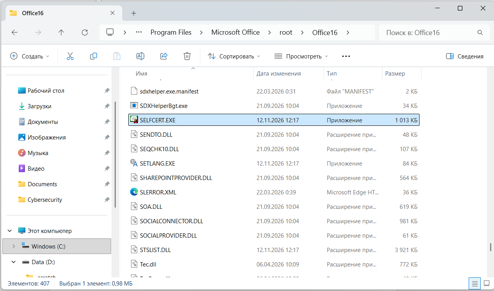

**2. Создание сертификата.** 

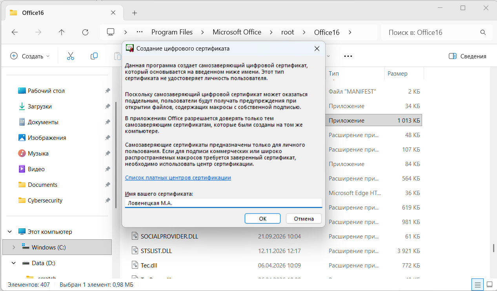

После нажатия ОК появилось сообщение «SelfCert: успех» — сертификат создан.

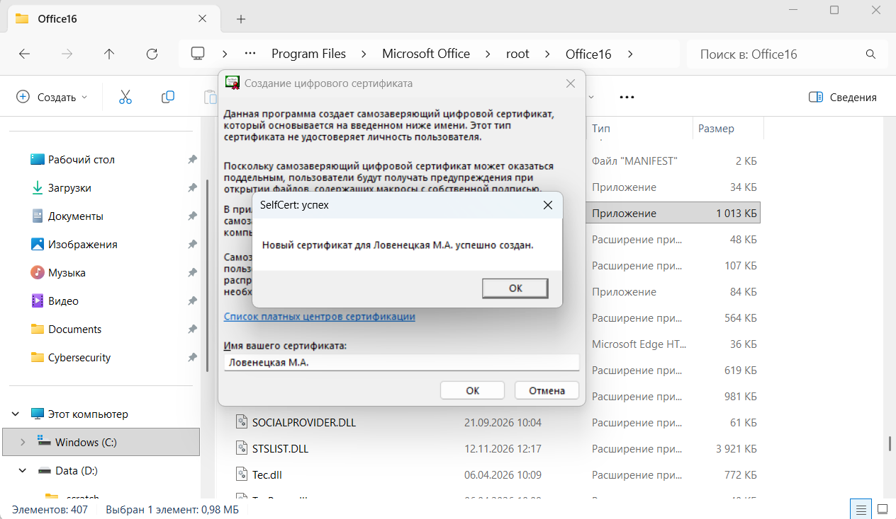

**3. Проверка в хранилище личных сертификатов.** Сертификат «Ловенецкая М.А.»

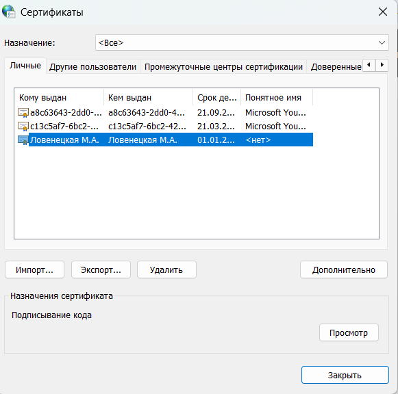

**4. Подпись документа Word.** Команда «Добавить цифровую подпись»: тема сертификата — «Ловенецкая М.А.», подпись добавляется кнопкой «Подписать».

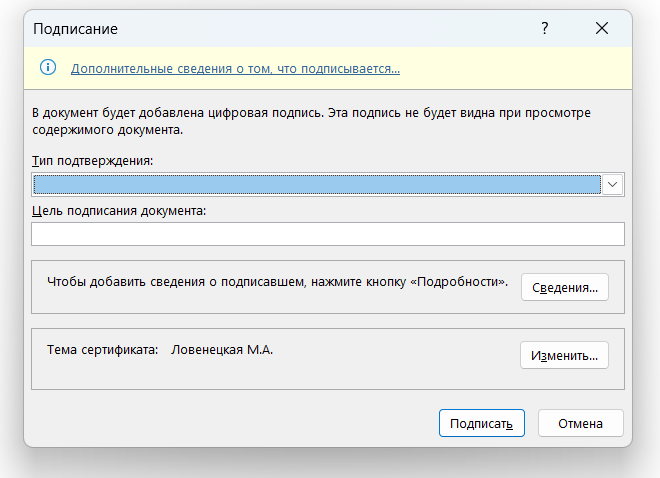

Подпись сохранена вместе с документом; при любом изменении документа она станет недействительной.

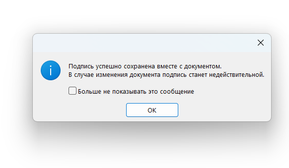

## Задание 11. Макрос форматирования таблицы и его подпись

1. Создана таблица 4×2 (Колонка 1…4; «Как», «Мне», «Все», «Интересно»).
2. Запись макроса: «Вид → Макросы → Запись макроса…» (имя латиницей без пробелов, назначение кнопке). Во время записи строка «Как / Мне / Все / Интересно» оформлена полужирным шрифтом — это и есть форматирование, которое повторяет макрос.

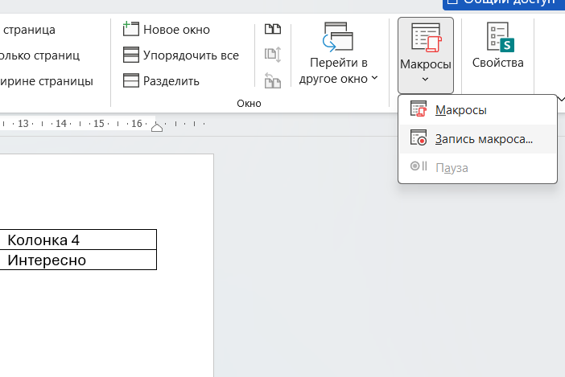

3. Подпись: окно «Состав подписи» показывает, что **подпись действительна** — подписанное содержимое не изменялось и сертификат действителен; тип подписи — **XAdES-EPES**; тема сертификата — «Ловенецкая М.А.».

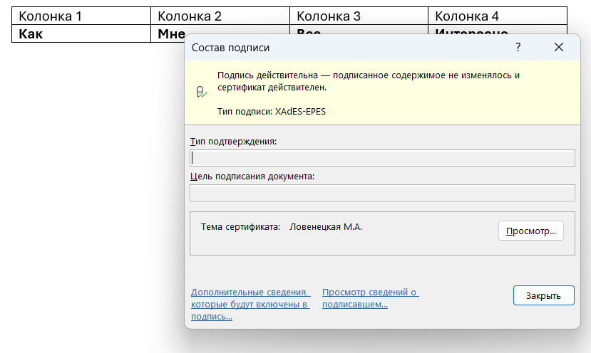

4. Сертификат (кнопка «Просмотр», вкладка «Состав»):

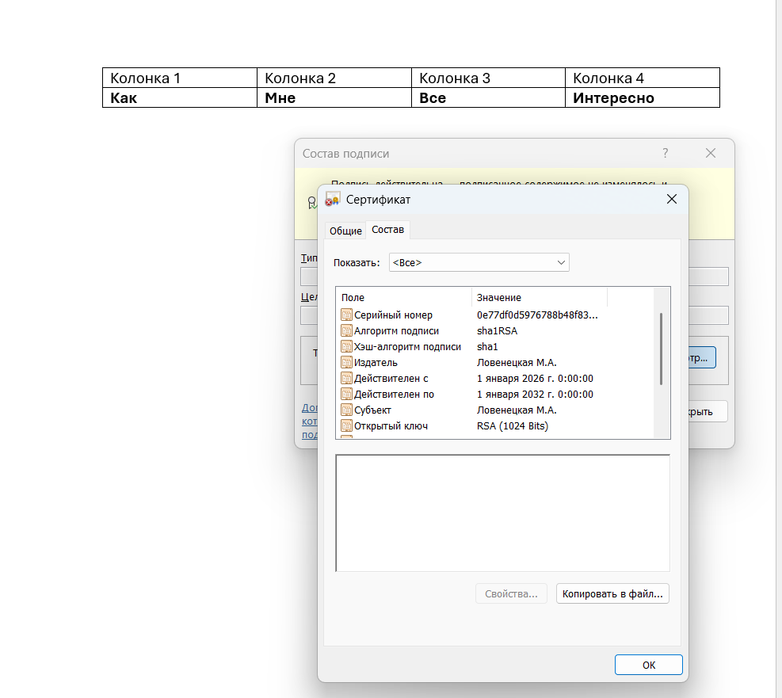

| Поле | Значение |
|---|---|
| Алгоритм подписи | **sha1RSA** |
| Хеш-алгоритм подписи | **sha1** |
| Издатель / Субъект | Ловенецкая М.А. (самозаверяющий) |
| Действителен с / по | 1 января 2026 г. — 1 января 2032 г. |
| Открытый ключ | **RSA (1024 Bits)** |


